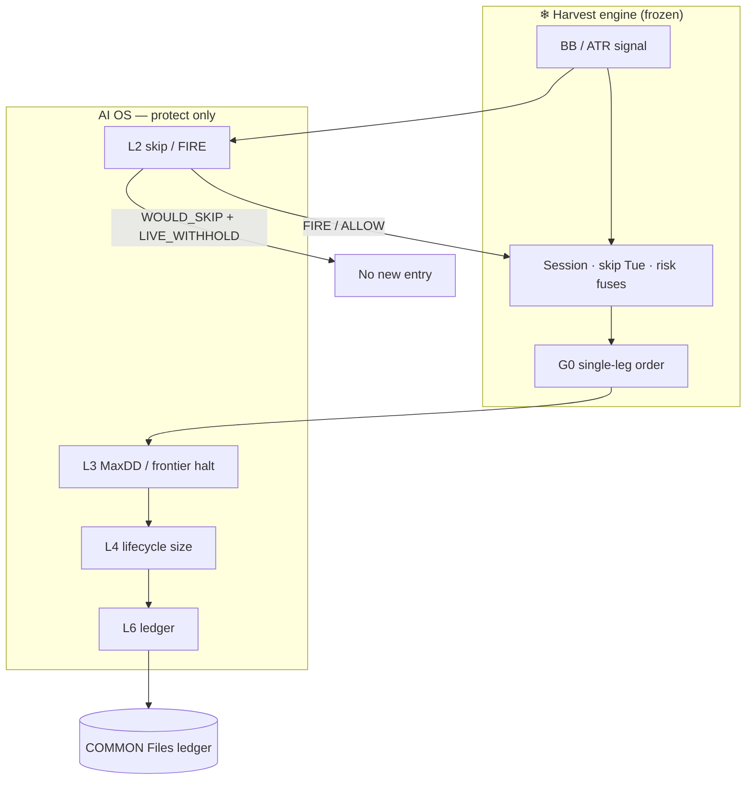
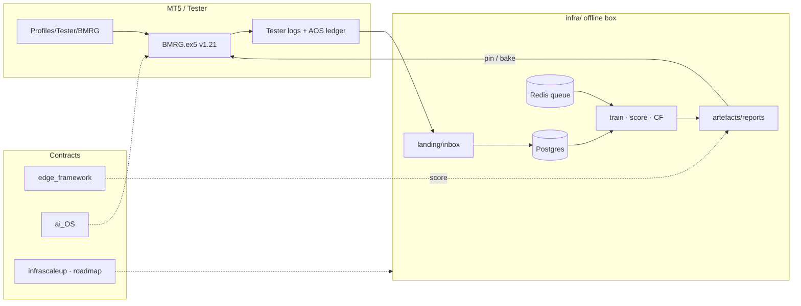
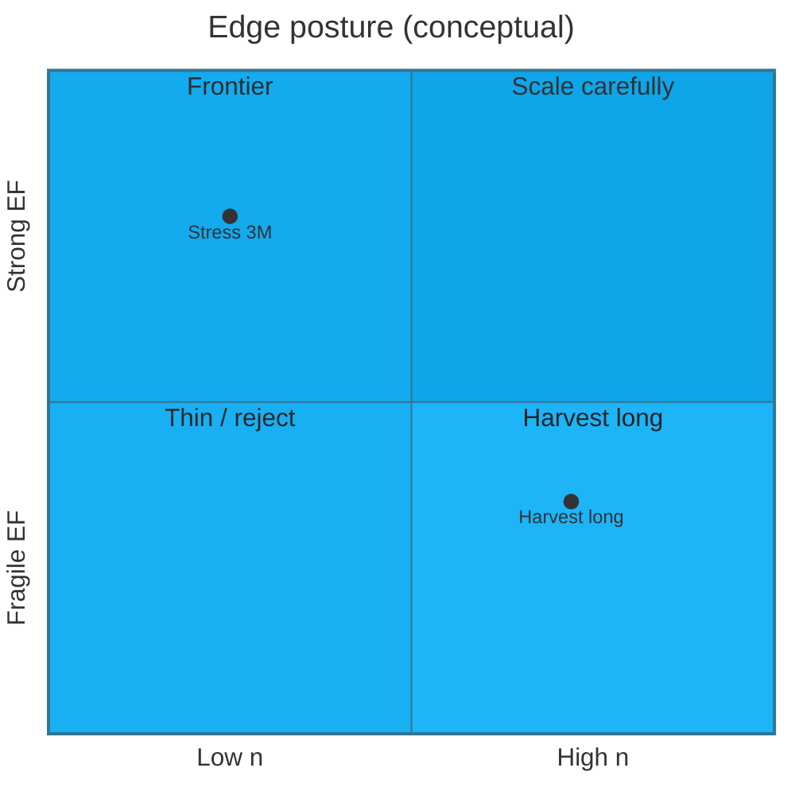
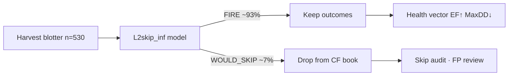
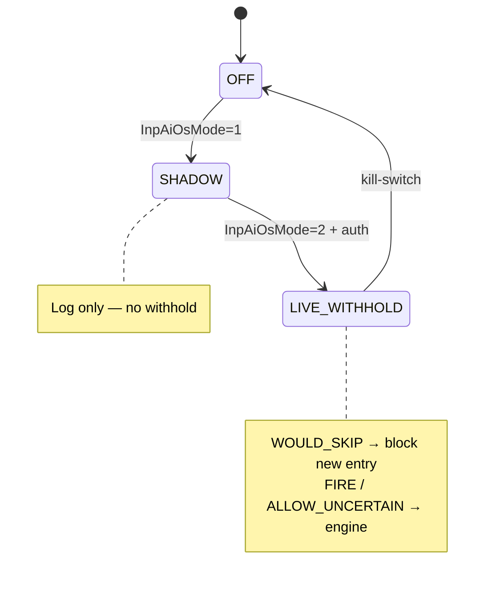
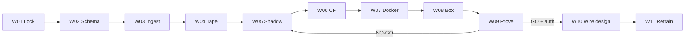
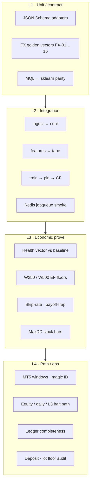
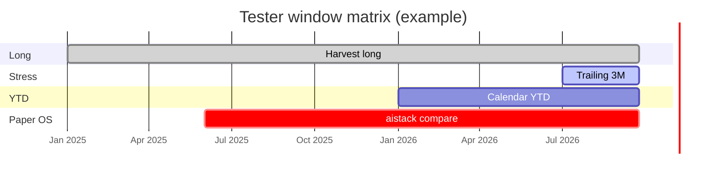
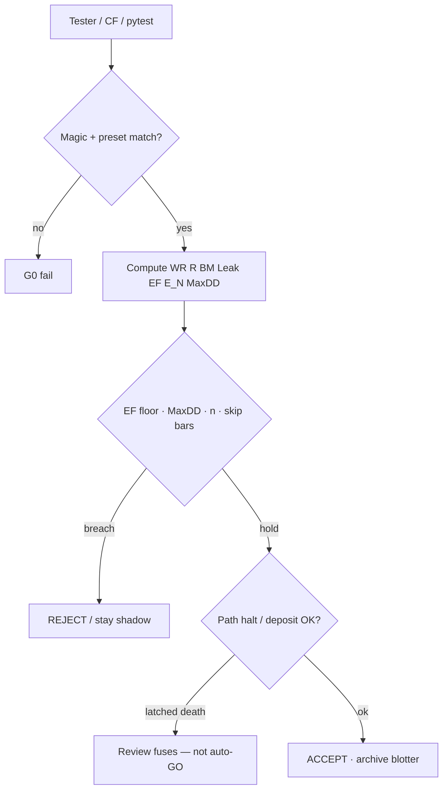

# BMRG

**Bollinger Mean-Reversion Grid** · EURUSD M5 · Edge-framed execution · AI OS as *protection*, never as entry rewrite

[](./BMRG.mq5)
[](./doc/presets/)
[](./doc/infra_roadmap.md)
[](./doc/infra_wiring_eligibility.md)
[](./infra/)

> **Design rule:** score and decide in **EF · E_N · MaxDD · n** — not raw tester balance alone.  
> **Authority:** blotter under [`doc/edge_framework.md`](./doc/edge_framework.md) wins; canvas and chat are display only.

---

## Contents

1. [What this is](#1-what-this-is)
2. [System architecture](#2-system-architecture)
3. [Engine performance](#3-engine-performance)
4. [Shadow OS impact](#4-shadow-os-impact)
5. [AI OS layers](#5-ai-os-layers)
6. [Infra scale-up](#6-infra-scale-up)
7. [Industry-grade testing](#7-industry-grade-testing)
8. [Presets](#8-presets)
9. [Works today / does not](#9-works-today--does-not)
10. [Quick start](#10-quick-start)

---

## 1. What this is

BMRG is a **frozen profitable mean-reversion engine** (Harvest) wrapped by an **AI Operating System** that may only *permit / withhold / size / halt*. Discovery (EDX) is closed. Infra (INF) trains and proves layers **offline**, then attaches under explicit auth.

| Piece | Role | Status |
| --- | --- | --- |
| **Harvest** | Champion engine · magic **8210204** · G0 single-leg | Frozen baseline |
| **EDX** | Edge discovery / bad-cell isolation | Closed — consume only |
| **AOS / aistack** | Paper OS overlay · magic **8399001** | STAY_PAPER |
| **INF W01–W11** | Schemas · ingest · tape · train · CF · box · prove · wire design · retrain | **DONE** |
| **EA v1.21** | `InpAiOsMode=LIVE_WITHHOLD` · baked INF L2 coeffs | Hook shipped · FT separate |



---

## 2. System architecture



| Plane | Owns | Path |
| --- | --- | --- |
| P-ACCESS | Limitation map | `infra/LIMITATIONS.md` |
| P-DATA | Schemas · ingest · landing | `infra/schemas/` · `infra/landing/` |
| P-TRAIN | L2 models · CF eval | `infra/src/train/` · `artefacts/models/` |
| P-BOX | Docker · Redis jobs | `infra/BOX.md` · `docker-compose` |
| P-OBS | Baselines · scorecards | `infra/baselines/` · `artefacts/reports/` |

---

## 3. Engine performance

**Geometry (Harvest):** SL **300** / TP **300** · RR **1.0** · session **12–20** · skip **Tue** · BBDev **2.2** · risk **0.5%** · G0.

### Locked health vector

Source: `infra/baselines/ENGINE_BASELINE_v1.json` · long window through **2026-09-24**.

| Metric | Value | Zone |
| --- | --- | --- |
| **n** | 530 | — |
| WR | ~54.5% | vs BWR 50% |
| BM | ~4.5 pp | — |
| Leak | 2.2 pp | proxy |
| **EF** | **1.77** (doc) · ~**2.33** (INF replay) | Fragile |
| **E_N** | **~+0.091 R** | Positive expectancy |
| MaxDD | ~21% (measured CF path) | Watch vs 15% equity fuse |
| Deposit ref | $400 (baseline JSON) | Tester deposit may differ |



*Stress 3M (thin n):* EF ~6.43 · n 49 — strong EF, warn on sample size.

---

## 4. Shadow OS impact

Offline counterfactual (INF-P4): same blotter, L2 **WOULD_SKIP** removed from the book — **not** a live equity path.

| | Engine | CF (39 skips) | Δ |
| --- | --- | --- | --- |
| n | 530 | 491 (~93% kept) | −39 |
| EF pp | 2.33 | **2.99** | +0.67 |
| E_N | 0.091 | 0.104 | +0.013 |
| MaxDD | ~21.0% | **~16.8%** | −4.1 pp |



**Interpretation:** lift is real on paper; path-dependent Tester equity (halts, deposit, W250) can diverge. Always re-score live runs under the edge framework.

---

## 5. AI OS layers

Normative story: [`doc/ai_OS.md`](./doc/ai_OS.md). Binding: OS may **never** invent entries.

| Layer | Capability | Status |
| --- | --- | --- |
| L1 | Regime / structure tape | Offline tape artefacts |
| **L2** | Skip gate (INF logistic) | **LIVE_WITHHOLD** baked in EA |
| **L3** | MaxDD / below-frontier halt | ON in INF preset |
| **L4** | Lifecycle size mod | ON · monitor `f` / W250 EF |
| L5 | Champ / challenger store | Infra promote path |
| L6 | Ledger | `BMRG_AOS_ledger_<magic>.csv` |
| L7–L10 | Sleeve / MAE / multi-horizon / unsigned | Paper / staged |



**aistack (8399001)** remains **STAY_PAPER** evidence that protection *can* lift EF — not a license to skip the INF prove path.

---

## 6. Infra scale-up



| Checkpoint | Artefact |
| --- | --- |
| Baseline lock | `infra/baselines/ENGINE_BASELINE_v1.json` |
| CF scorecard | `infra/artefacts/reports/INF-P4-T04_cf_scorecard.json` |
| Wire auth | `infra/artefacts/ops/WIRE_AUTHORISATION.json` |
| Full regression | `infra/artefacts/reports/INF_FULL_REGRESSION.json` · **49** pytest |
| Live pin | `L2skip_inf_p92_20260927_223519` · EA bake + `LATEST_LIVE/PIN.json` |

**Forbidden without extra auth:** `AOS_LIVE_FT` (forward-test programme).

---

## 7. Industry-grade testing

BMRG treats Strategy Tester as **one instrument**, not the verdict. Practice mirrors quant research + software CI.

### 7.1 Test pyramid



### 7.2 Practice checklist

| Practice | BMRG binding |
| --- | --- |
| **Fixed identity** | Magic + `preset_id` + EA semver (G-J) |
| **Currency only** | Pips mode inadmissible for Stage 1–3 |
| **Declared 1R** | SL points × volume × tick value |
| **Walk-forward / folds** | INF train + per-fold skip/EF (box) |
| **Counterfactual before live** | CF scorecard ACCEPT before withhold |
| **Parity** | Sklearn vs `AOS_L2skip_inf.mqh` max\|Δ\| ≈ 0 |
| **Regression gate** | `make test` · `INF_FULL_REGRESSION.json` |
| **Path ≠ paper** | Re-run YTD / 12M / stress; score halt latches |
| **Cost honesty** | Leak policy locked; flag `costs_defaulted` |
| **No silent wire** | `WIRE_AUTHORISATION.json` allow-list |
| **Blotter hygiene** | Inbox → `blotter/archive/<TASK>/` after review |
| **One task at a time** | EDX/INF IDs; no mixed blotters |

### 7.3 Recommended window matrix



| Window | Why |
| --- | --- |
| Long | Lock EF / n vs `ENGINE_BASELINE_v1` |
| Stress 3M | Regime / thin-n warn |
| YTD | Path health without full history |
| Same magic across windows | Removes identity ambiguity |

### 7.4 Verdict flow



---

## 8. Presets

Doc copies: [`doc/presets/`](./doc/presets/) · load from `MQL5/Profiles/Tester/BMRG/`.

| Role | Preset | Magic |
| --- | --- | --- |
| Harvest baseline | `EDX-P2-T04_SL300_TP300_RR1_champFilters_G0_long.set` | **8210204** |
| aistack paper | `aistack.set` | **8399001** |
| INF LIVE_WITHHOLD | `INF-LIVE_WITHHOLD_Harvest_long.set` | **8210204** |
| Export-only | `EXP-P7-T03_export_Harvest_long.set` | 8210205 |

---

## 9. Works today / does not

| Works | Does not (yet) |
| --- | --- |
| Harvest engine + INF offline pipeline | Treat CF EF as live equity forecast |
| EA LIVE_WITHHOLD with baked L2 | `AOS_LIVE_FT` without extra auth |
| Ledger per magic · pytest 49 | Assume Tester deposit = baseline $400 |
| Preset library under `doc/presets/` | Reopen EDX as a campaign |

---

## 10. Quick start

```bat
:: Infra box
cd infra
docker-compose up -d postgres redis
make.bat test
make.bat report

:: Tester
:: 1. Load Profiles/Tester/BMRG/INF-LIVE_WITHHOLD_Harvest_long.set
:: 2. EURUSD M5 · every tick · ACCOUNT CURRENCY
:: 3. Identify run by InpMagic=8210204
:: 4. Score blotter under doc/edge_framework.md
:: 5. Archive blotter/inbox → blotter/archive/<TASK_ID>/
```

| Doc | Use |
| --- | --- |
| [`doc/edge_framework.md`](./doc/edge_framework.md) | How to score |
| [`doc/ai_OS.md`](./doc/ai_OS.md) | Layer stack |
| [`doc/infra_roadmap.md`](./doc/infra_roadmap.md) | Week board |
| [`doc/infrascaleup.md`](./doc/infrascaleup.md) | Contracts |
| [`infra/AGENT_PATHS.md`](./infra/AGENT_PATHS.md) | Agent Read table |
| [`doc/presets/README.md`](./doc/presets/README.md) | Preset index |

---

### Bottom line

Harvest is the profitable core. INF proved a modest L2 skip lift offline and shipped a **withhold-only** EA hook under operator auth. Industry posture: **contract tests → CF prove → multi-window path tests → blotter archive** — never a single Tester balance as truth.

*Report snapshot aligned 2026-09-28 · BMRG v1.21 · INF W01–W11 DONE*
