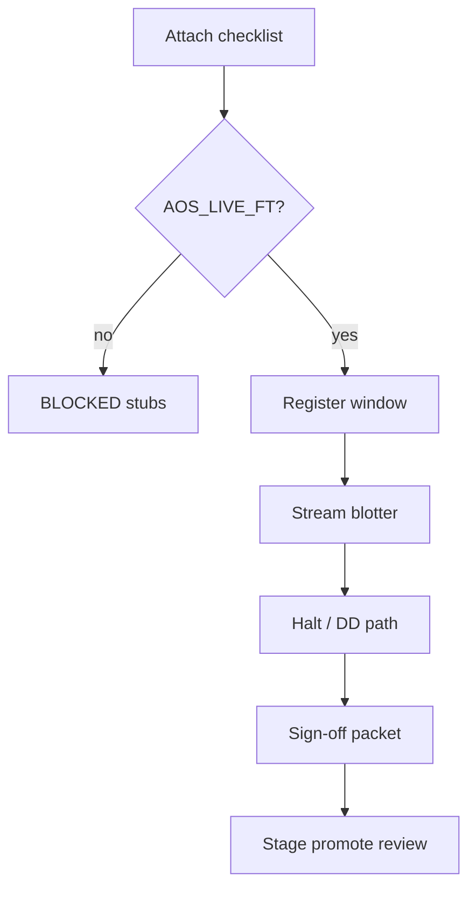

# Client FT console — design (UI-P8)

**Status:** Design shipped · mutate FT **BLOCKED** until `AOS_LIVE_FT` leaves `forbids_unless_extra_auth`  
**Route:** `/ft`  
**Auth:** `WIRE_AUTHORISATION.json` · `AuthGate` · `allows('AOS_LIVE_FT')`

---

## Purpose

Operator programme for **forward-test** (demo → stage), distinct from:

| Surface | Meaning |
| --- | --- |
| `/live` | Chart-attached observe (journal / fuses) |
| Demo attach | Evidence that EA boots — **not** FT ship |
| `/ft` | Programme register, blotter stream, halt replay, sign-off |

---

## Flows

1. **Attach checklist** — chart · preset · magic · journal paths (always visible).  
2. **Auth gate** — hard wall; Operator role alone is insufficient if action is forbidden.  
3. **Run register** — window dates, deposit, magic, start/stop notes (P9).  
4. **Blotter stream** — demo deals adapter preview (P9).  
5. **Path replay** — equity + fuse events vs L3 (P9).  
6. **Sign-off** — export packet for promotion stage (P9).

---

## Metrics contract

Same EF vocabulary as Health / Prove:

- EF · E_N · MaxDD · n · skip-rate · fire-count  
- Halt path (equity / daily / L3)  
- **Forbidden:** AI confidence KPI · balance-only hero · silent enable of FT

---

## Risks

| Risk | Mitigation |
| --- | --- |
| Demo attach sold as FT complete | Banner + checklist copy |
| UI toggles kill / places orders | Non-goal — display only |
| Enable FT without auth file | `AuthGate` + forbids list |
| CF lift treated as live FT | Prove path≠paper; FT uses path metrics |

---

## Forbidden in UI code until auth

- Enabling mutate buttons for FT without `allows('AOS_LIVE_FT')`  
- Claiming production readiness from demo alone  
- Writing LIVE pin from FT screen

---

## Exit (P8)

- [x] This doc  
- [x] Attach checklist UI on `/ft`  
- [x] Metrics contract table  
- [x] `AuthGate` hard wall · `AOS_LIVE_FT` still forbidden in WIRE
