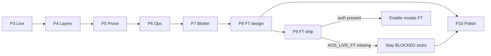

# Client UI — P3→P10 Implementation Plan

**Status:** Shipped (P9 FT mutate **BLOCKED**)  
**Design lock:** Ledger Noir + Signal Teal (`client/design/UI_PHILOSOPHY.md`)  
**Rule:** Read-path first · no order tickets · L3 outranks L2 · EF vocab only

---

## Sequence (mandatory)

| Phase | Week | Ship | Exit criteria (must hold) | Status |
| --- | --- | --- | --- | --- |
| **P3** | W04 | `/live` | Demo journal sample renders · kill is display-only | **DONE** |
| **P4** | W05 | `/layers` | Ledger from skip/AOS CSV · WOULD_SKIP ≠ “smarter entry” | **DONE** |
| **P5** | W06 | `/prove` | CF not sold as live equity · link skip audit | **DONE** |
| **P6** | W07 | `/ops` | Mutate gated · dry-run fixture works | **DONE** |
| **P7** | W08 | `/blotter` | Magic↔preset map · CURRENT.md visible | **DONE** |
| **P8** | W09 | `/ft` design | Doc + checklist · `AOS_LIVE_FT` still forbidden in code | **DONE** |
| **P9** | W10 | FT ship | **BLOCKED** unless auth includes `AOS_LIVE_FT` | **BLOCKED** |
| **P10** | W11 | Polish | a11y · exports · README link · checklist | **DONE** |

---

## Per-phase build checklist

### P3 Live
- [x] IdentityPanel (magic, preset, ea_version, symbol/TF)
- [x] ModePanel (OFF/SHADOW/LIVE_WITHHOLD + kill display)
- [x] FuseStrip (equity/daily/L3/pause/f)
- [x] JournalBridge (last N lines from fixture)
- [x] Exit: no remote kill toggle

### P4 Layers
- [x] LayerStackMap L1–L10 with L3 outrank
- [x] LedgerGrid filter FIRE/ALLOW/SKIP
- [x] L4LifecyclePanel stuck EF=0 / f=0.75 detect
- [x] L7–L10 STAY_PAPER stubs

### P5 Prove
- [x] CfCompare engine vs CF
- [x] SkipAuditExplorer (+ md link)
- [x] PathNotPaperBanner
- [x] VerdictTimeline

### P6 Ops
- [x] PinBoard LIVE/SHADOW/PRIOR
- [x] PromoteDryRun + gated buttons
- [x] JobQueuePanel
- [x] CorrelationTrace search

### P7 Blotter
- [x] Inbox/Archive browser
- [x] ScorecardViewer
- [x] PresetLibrary
- [x] ReviewAssist checklist

### P8 FT design
- [x] `doc/client_ft_console.md`
- [x] Attach checklist UI
- [x] FT metrics contract display
- [x] AuthGate hard wall

### P9 FT ship
- [x] Run register / blotter / path / sign-off **stubs**
- [x] Enable only if `allows('AOS_LIVE_FT')` — else BLOCKED banner

### P10 Polish
- [x] Visual pack notes
- [x] a11y focus/skip link
- [x] JSON/CSV export helpers
- [x] Root README Client section

---

## Non-goals (all phases)

No chart trading · no EDX reopen · no balance-only hero · no silent FT enable · no page-local theme forks.
