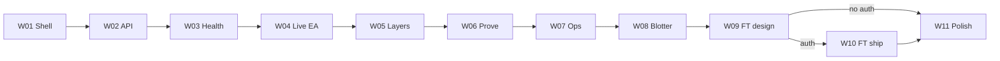
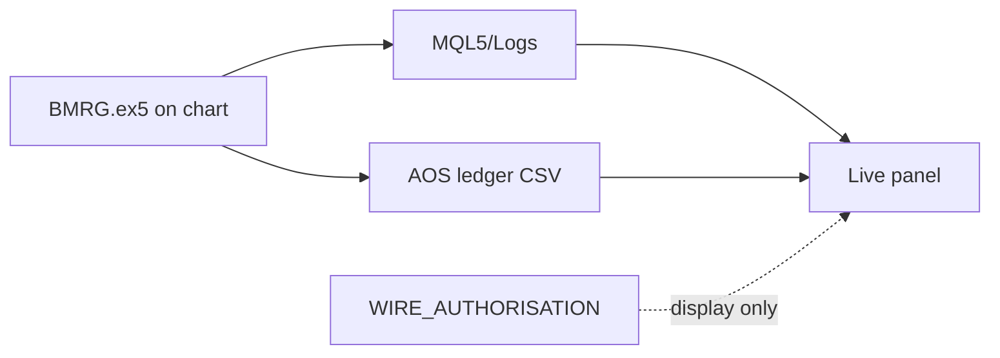
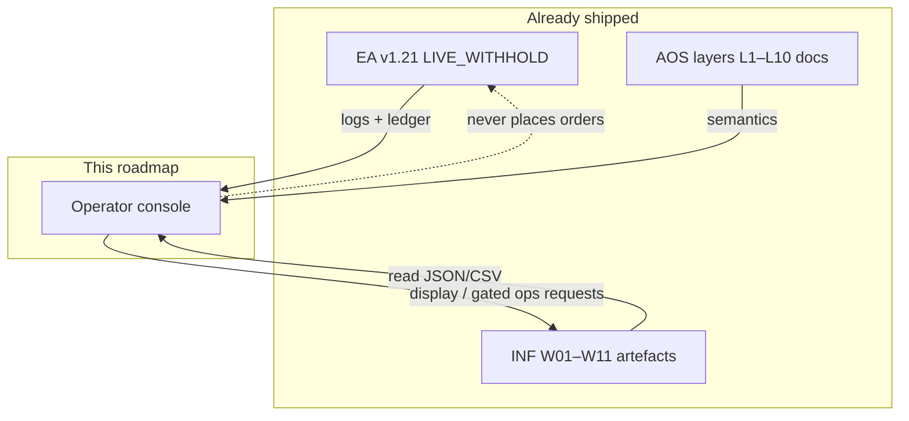

# BMRG Client UI — Weekly Implementation Roadmap

**Version:** 0.1  
**Status:** Active plan — read-first operator console; no order placement from UI  
**Implementation table:** §2 (master) + per-week Implement tables in §5  
**Companions:** `README.md` · `doc/infra_roadmap.md` · `doc/ai_OS.md` · `doc/edge_framework.md` · `doc/infra_wiring_plan.md` · `infra/AGENT_PATHS.md`  
**Engine / OS lock:** Harvest magic **8210204** · EA **v1.21** · L2 pin `L2skip_inf_p92_20260927_223519` · mode **LIVE_WITHHOLD**  
**Auth boundary:** UI may **observe / explain / request ops**; it must not bypass `WIRE_AUTHORISATION.json` or place trades

---

## 0. How to use this roadmap

| ID family | Meaning |
| --- | --- |
| **UI-W##** | Calendar implementation week (one week at a time) |
| **UI-P#-T##** | Task inside a client phase |
| **UI-API-*** | Backend read/adapter endpoints consumed by the shell |
| **UI-FT-*** | Forward-test console surfaces (requires `AOS_LIVE_FT` auth) |

**Rules**

1. Finish the current week → week exit checklist → then open the next week.  
2. One **UI-P#-T##** at a time (first `PENDING` in order).  
3. **Read-path first:** artefacts & ledgers before any mutate controls.  
4. Speak **WR / R / BM / Leak / EF / E_N / MaxDD / skip-rate / fire-count** — never “AI confidence” as a KPI.  
5. UI never rewrites entries, SL/TP, or magic; L3 outranks L2 in all displays.  
6. Do not reopen EDX; do not treat `aistack` as production wiring.  
7. Demo chart attach ≠ FT programme — FT screens stay gated until explicit auth.

**Mandatory sequence**

```
shell + design system (W01)
  → artefact API + health (W02–W03)
  → live EA / ledger / layers (W04–W05)
  → CF prove + skip audit (W06)
  → ops pin / jobs / blotter (W07–W08)
  → FT console design (W09) → ship gated FT (W10) → polish / a11y (W11)
```



---

## 1. Week board (current)

| Week ID | Phase | Focus | Status |
| --- | --- | --- | --- |
| UI-W01 | UI-P0 | Product brief · IA · design tokens · app shell | **DONE** |
| UI-W02 | UI-P1 | Read API over INF artefacts + auth stub | **DONE** |
| UI-W03 | UI-P2 | Health vector · baseline compare · window matrix | **DONE** |
| UI-W04 | UI-P3 | Live EA status · mode · kill · journal bridge | **DONE** |
| UI-W05 | UI-P4 | Layer console L1–L10 (+ L7–L10 stubs) · ledger | **DONE** |
| UI-W06 | UI-P5 | CF prove · skip audit · path≠paper callouts | **DONE** |
| UI-W07 | UI-P6 | Model pin · promote/rollback · job queue | **DONE** |
| UI-W08 | UI-P7 | Blotter inbox/archive · preset library | **DONE** |
| UI-W09 | UI-P8 | FT programme UX design (gated) | **DONE** |
| UI-W10 | UI-P9 | FT console ship **only if authorised** | **BLOCKED** |
| UI-W11 | UI-P10 | Polish · a11y · export · regression screenshots | **DONE** |

**Board complete through P10.** P9 FT ship remains **BLOCKED** until `AOS_LIVE_FT`.

---

## 2. Implementation table (master)

Execute top → bottom. Status: `PENDING` / `RUNNING` / `DONE` / `REJECTED` / `BLOCKED`.

| Week | Task ID | Plane | Implement (artefact / path) | Responsibility | Status |
| --- | --- | --- | --- | --- | --- |
| UI-W01 | `UI-P0-T01` | P-PRODUCT | `doc/client_product_brief.md` | Personas, jobs-to-be-done, non-goals | DONE |
| UI-W01 | `UI-P0-T02` | P-IA | `doc/client_ia.md` · sitemap | Routes: Home · Health · Live · Layers · Prove · Ops · Blotter · FT | DONE |
| UI-W01 | `UI-P0-T03` | P-DESIGN | `client/design/tokens.css` · theme | Brand, type, colour; avoid generic AI-dashboard purple | DONE |
| UI-W01 | `UI-P0-T04` | P-SHELL | `client/app` shell + nav + empty states | One composition layout; dark ops-console, not marketing | DONE |
| UI-W02 | `UI-P1-T01` | P-API | `client/api/openapi.yaml` | Read contracts for eval, baseline, pin, ledger, jobs | DONE |
| UI-W02 | `UI-P1-T02` | P-API | `client/api/adapters/artefacts.ts` | Map `LATEST_EVAL` · `ENGINE_BASELINE_v1` · PIN · scorecards | DONE |
| UI-W02 | `UI-P1-T03` | P-API | `client/api/fs_bridge` or HTTP stub | Local/dev read of `infra/artefacts/**` (no Tester UI) | DONE |
| UI-W02 | `UI-P1-T04` | P-AUTH | role stub Operator / Viewer | Viewer = read-only; Operator sees gated actions disabled without auth | DONE |
| UI-W03 | `UI-P2-T01` | P-HEALTH | Health Vector card | WR R BM Leak EF E_N MaxDD n · zone badge | DONE |
| UI-W03 | `UI-P2-T02` | P-HEALTH | Baseline delta strip | Live/eval vs `ENGINE_BASELINE_v1` (± floors) | DONE |
| UI-W03 | `UI-P2-T03` | P-HEALTH | Window matrix view | Long · Stress 3M · YTD · custom; magic ID | DONE |
| UI-W03 | `UI-P2-T04` | P-HEALTH | Accept-bar meter | n≥100 · W250 EF floor · MaxDD slack · skip-rate | DONE |
| UI-W04 | `UI-P3-T01` | P-LIVE | EA Identity panel | magic · preset_id · ea_version · symbol/TF | DONE |
| UI-W04 | `UI-P3-T02` | P-LIVE | Mode control display | OFF / SHADOW / LIVE_WITHHOLD · kill-switch state | DONE |
| UI-W04 | `UI-P3-T03` | P-LIVE | Fuse strip | equityHalt · dailyLoss · L3 halt · pause · derisk `f` | DONE |
| UI-W04 | `UI-P3-T04` | P-LIVE | Journal bridge | Tail `MQL5/Logs` / ledger; last bar, sig, spr | DONE |
| UI-W05 | `UI-P4-T01` | P-LAYERS | Layer stack map | L1–L10 status chips; L3 outrank callout | DONE |
| UI-W05 | `UI-P4-T02` | P-LEDGER | Decision ledger table | FIRE / ALLOW_UNCERTAIN / SKIP · proba · thr · reason | DONE |
| UI-W05 | `UI-P4-T03` | P-LAYERS | L4 lifecycle panel | W250 EF/EN · life · `f_mult` (flag EF=0 stuck) | DONE |
| UI-W05 | `UI-P4-T04` | P-LAYERS | L7–L10 stubs | Sleeve / MAE / soft-veto / HITL — paper badges | DONE |
| UI-W06 | `UI-P5-T01` | P-PROVE | CF compare view | Engine vs CF EF/E_N/MaxDD/n · skip count | DONE |
| UI-W06 | `UI-P5-T02` | P-PROVE | Skip audit explorer | Clusters from `INF-P6-T02` · FP tags | DONE |
| UI-W06 | `UI-P5-T03` | P-PROVE | Path≠paper banner | Deposit · halt latch · window start mismatches | DONE |
| UI-W06 | `UI-P5-T04` | P-PROVE | Verdict timeline | ACCEPT / REJECT / USER GO · artefact links | DONE |
| UI-W07 | `UI-P6-T01` | P-OPS | Model pin board | LIVE / SHADOW / PRIOR · semver · bake parity | DONE |
| UI-W07 | `UI-P6-T02` | P-OPS | Promote / rollback UI | Dry-run first; requires Operator + auth flags | DONE |
| UI-W07 | `UI-P6-T03` | P-OPS | Job queue panel | `LATEST_JOB` · enqueue status · worker health | DONE |
| UI-W07 | `UI-P6-T04` | P-OPS | Correlation trace | event_id ingest→eval from JSONL | DONE |
| UI-W08 | `UI-P7-T01` | P-BLOTTER | Inbox / archive browser | `blotter/inbox` · `archive/<TASK_ID>` · CURRENT.md | DONE |
| UI-W08 | `UI-P7-T02` | P-BLOTTER | Scorecard viewer | JSON/MD scorecards; G0 identity check | DONE |
| UI-W08 | `UI-P7-T03` | P-PRESET | Preset library UI | `doc/presets` + Profiles twins · magic map | DONE |
| UI-W08 | `UI-P7-T04` | P-BLOTTER | Clear-after-review assist | Checklist only — agent/ops still archives | DONE |
| UI-W09 | `UI-P8-T01` | P-FT | `doc/client_ft_console.md` | FT programme UX; gates; forbidden without auth | DONE |
| UI-W09 | `UI-P8-T02` | P-FT | Demo attach checklist UI | Chart · inputs · magic · journal paths | DONE |
| UI-W09 | `UI-P8-T03` | P-FT | FT metrics contract | Same EF language; no vanity balance hero | DONE |
| UI-W09 | `UI-P8-T04` | P-FT | Auth gate component | Reads `WIRE_AUTHORISATION` · blocks mutate | DONE |
| UI-W10 | `UI-P9-T01` | P-FT | FT run register | Window · deposit · magic · start/stop notes | **BLOCKED** until `AOS_LIVE_FT` |
| UI-W10 | `UI-P9-T02` | P-FT | Live blotter stream | Demo deals → adapter preview | BLOCKED |
| UI-W10 | `UI-P9-T03` | P-FT | Halt / DD path replay | Equity curve + fuse events | BLOCKED |
| UI-W10 | `UI-P9-T04` | P-FT | FT sign-off packet | Export packet for promotion stage | BLOCKED |
| UI-W11 | `UI-P10-T01` | P-QA | Visual regression pack | Key screens screenshots / Percy or local | DONE |
| UI-W11 | `UI-P10-T02` | P-A11Y | Keyboard · contrast · labels | Ops console usable without pointer only | DONE |
| UI-W11 | `UI-P10-T03` | P-EXPORT | CSV/JSON export | Health · ledger · CF deltas | DONE |
| UI-W11 | `UI-P10-T04` | P-DOCS | `client/README.md` · link from root README | Runbook for operators | DONE |

---

## 3. Weekly cadence

| Step | Action |
| --- | --- |
| Start of week | Read §2 rows for that week; touch only listed task IDs |
| During week | Execute in ID order; mark Status in §2 |
| End of week | Run week exit checklist (§5); archive notes under `blotter/archive/UI-W##/` |
| Pass | Mark week `DONE` in §1; open next week |
| Fail | Stay on week; fix gaps only — no scope adds / no trade buttons |

---

## 4. Accept bar (every UI week)

| Check | Bar |
| --- | --- |
| Metric vocabulary | Only EF-framework fields on primary cards |
| Identity | Magic + preset + ea_version visible on Live / Health |
| No false agency | No “AI confidence” KPI; no order ticket UI |
| Auth | Mutate actions disabled unless `WIRE_AUTHORISATION` allows |
| L3 precedence | Halt states visually outrank L2 skip |
| Artefact fidelity | Numbers match JSON artefacts within display rounding |
| Path honesty | CF vs live equity clearly separated |
| Perf | Shell TTI usable on operator laptop; no blocking 10MB JSON parse on home |

---

## 5. Per-week implement tables

### UI-W01 — Shell & product lock (UI-P0)

**Goal:** Know who the UI is for and ship a navigable shell.

| Task ID | Artefact | Implement |
| --- | --- | --- |
| `UI-P0-T01` | `doc/client_product_brief.md` | Personas: Operator (demo/FT), Researcher (CF/prove), Viewer (read-only) |
| `UI-P0-T02` | `doc/client_ia.md` | Route map + empty/error states |
| `UI-P0-T03` | `client/design/tokens.css` | Tokens; expressive type; atmospheric bg — not purple SaaS default |
| `UI-P0-T04` | `client/` app shell | Nav matching IA; Home = one composition (status + next action) |

**Exit**

- [x] Brief + IA reviewed  
- [x] Shell renders all routes as placeholders  
- [x] Non-goals listed: no chart trading, no EDX reopen, no balance-only hero  

**P0 artefacts:** `doc/client_product_brief.md` · `doc/client_ia.md` · `client/design/*` · `client/src/components/{primitives,motion,shells,patterns}` · Home proof + FT placeholder  

---

### UI-W02 — Artefact API (UI-P1)

**Goal:** Stable read adapters over INF / AGENT_PATHS — no Tester dependency.

| Task ID | Artefact | Implement |
| --- | --- | --- |
| `UI-P1-T01` | `client/api/openapi.yaml` | Endpoints: `/health/latest`, `/baseline`, `/pin`, `/ledger`, `/jobs`, `/auth` |
| `UI-P1-T02` | adapters | Parse `LATEST_EVAL.json`, `ENGINE_BASELINE_v1.json`, PIN, CF scorecard |
| `UI-P1-T03` | fs/http bridge | Dev mode: read `infra/artefacts/**`; prod: optional local API |
| `UI-P1-T04` | auth stub | Viewer vs Operator; surface `allows` / `forbids_unless_extra_auth` |

**Exit**

- [x] OpenAPI validates  
- [x] Home can load baseline EF without hardcoding  
- [x] Missing artefact → explicit empty state (not crash)  

**P1 artefacts:** `client/api/openapi.yaml` · `adapters/artefacts.ts` · `fs_bridge.ts` · `src/api/*` · Home wired to `/api/baseline`  

---

### UI-W03 — Health & windows (UI-P2)

**Goal:** Forward-facing score surface matching edge framework.

| Task ID | Artefact | Implement |
| --- | --- | --- |
| `UI-P2-T01` | Health Vector | Primary metrics card + zone |
| `UI-P2-T02` | Baseline Δ | Coloured deltas vs floors in `PHASE_EXITS` / baseline JSON |
| `UI-P2-T03` | Window matrix | Long / stress / YTD selectors; magic badge |
| `UI-P2-T04` | Accept-bar | Visual pass/warn/fail for n, W250 EF, MaxDD, fires |

**Exit**

- [x] Numbers reconcile with `ENGINE_BASELINE_v1` fixture  
- [x] No equity-balance-as-hero on this page  

**P2 artefacts:** `client/src/features/health/*` · `routes/Health.tsx` · baseline adapter windows + iteration_bar  

---

### UI-W04 — Live EA bridge (UI-P3)

**Goal:** Reflect chart-attached EA state (demo or live) without controlling orders.



| Task ID | Artefact | Implement |
| --- | --- | --- |
| `UI-P3-T01` | Identity | magic 8210204 · INF preset · v1.21 |
| `UI-P3-T02` | Mode | LIVE_WITHHOLD / SHADOW / OFF · kill |
| `UI-P3-T03` | Fuses | equity / daily / L3 / pause / `f` |
| `UI-P3-T04` | Journal | Last N INFO/WARN/TRADE lines; link to log path |

**Exit**

- [x] Demo attach scenario (journal sample) renders correctly  
- [x] Kill-switch shown as EA input state — UI does not toggle MT5 remotely in W04  

---

### UI-W05 — Layers & ledger (UI-P4)

**Goal:** Make AI OS layers visible and auditable.

| Task ID | Artefact | Implement |
| --- | --- | --- |
| `UI-P4-T01` | Layer map | Interactive L1–L10; L3 “outranks” styling |
| `UI-P4-T02` | Ledger grid | Filter by decision; show model semver |
| `UI-P4-T03` | L4 panel | Detect stuck W250 EF=0 / f=0.75 derisk |
| `UI-P4-T04` | L7–L10 | Stub cards with STAY_PAPER / not shipped |

**Exit**

- [x] Ledger loads `BMRG_AOS_ledger_<magic>.csv` or skip_ledger artefact  
- [x] L2 WOULD_SKIP never styled as “smarter entry”  

---

### UI-W06 — Prove & honesty (UI-P5)

**Goal:** Operator sees CF lift **and** why live path can diverge.

| Task ID | Artefact | Implement |
| --- | --- | --- |
| `UI-P5-T01` | CF compare | Side-by-side engine vs CF from P4 scorecard |
| `UI-P5-T02` | Skip audit | Cluster table + hostile-cell tags |
| `UI-P5-T03` | Path≠paper | Deposit 200 vs 400, halt latch, window start |
| `UI-P5-T04` | Verdicts | Timeline from INF-P6 / USER GO / wire auth |

**Exit**

- [x] CF EF 2.99 not presented as live equity forecast  
- [x] Link to `INF-P6-T02_skip_audit.md`  

---

### UI-W07 — Ops console (UI-P6)

**Goal:** Pin / jobs / promote — gated mutate UX.

| Task ID | Artefact | Implement |
| --- | --- | --- |
| `UI-P6-T01` | Pin board | LIVE · SHADOW · PRIOR · bake parity badge |
| `UI-P6-T02` | Promote UI | Dry-run JSON; rollback confirm |
| `UI-P6-T03` | Queue | Job id · status · `make queue-demo` mirror |
| `UI-P6-T04` | Correlation | Search by event_id |

**Exit**

- [x] Mutate buttons disabled without Operator + allow-list  
- [x] Dry-run path works with fixture `infra/fixtures/promote/dry_run.json`  

---

### UI-W08 — Blotter & presets (UI-P7)

**Goal:** Close the loop with archives and preset identity.

| Task ID | Artefact | Implement |
| --- | --- | --- |
| `UI-P7-T01` | Blotter browser | Inbox vs archive/<TASK> |
| `UI-P7-T02` | Scorecard viewer | Render SCORECARD.json/md |
| `UI-P7-T03` | Preset library | Harvest / aistack / INF / EXP cards |
| `UI-P7-T04` | Review assist | Checklist aligned with blotter-clear rule |

**Exit**

- [x] Magic→preset map matches `doc/presets/README.md`  
- [x] CURRENT.md pointer visible  

---

### UI-W09 — FT design only (UI-P8)

**Goal:** Design forward-test console; **do not ship FT** without auth.

| Task ID | Artefact | Implement |
| --- | --- | --- |
| `UI-P8-T01` | `doc/client_ft_console.md` | Flows, risks, metrics |
| `UI-P8-T02` | Attach checklist | Demo chart steps |
| `UI-P8-T03` | FT metrics | EF language + halt path |
| `UI-P8-T04` | Auth gate | Hard wall for UI-W10 |

**Exit**

- [x] Design reviewed  
- [x] `AOS_LIVE_FT` still forbidden in UI code paths  

---

### UI-W10 — FT ship (UI-P9) — auth gate

**Goal:** Only after `WIRE_AUTHORISATION` includes `AOS_LIVE_FT` (or successor).

| Task ID | Artefact | Implement |
| --- | --- | --- |
| `UI-P9-T01` | Run register | Window · deposit · magic |
| `UI-P9-T02` | Live blotter | Adapter preview from demo |
| `UI-P9-T03` | Path replay | Equity + fuses |
| `UI-P9-T04` | Sign-off packet | Export for stage promotion |

**Exit**

- [x] Auth flag present or week stays **BLOCKED**  
- [x] No production claim without stage packet  

---

### UI-W11 — Polish (UI-P10)

**Goal:** Ship-quality operator console.

| Task ID | Artefact | Implement |
| --- | --- | --- |
| `UI-P10-T01` | Visual pack | Golden screens |
| `UI-P10-T02` | a11y pass | Focus order · contrast |
| `UI-P10-T03` | Exports | Health / ledger / CF |
| `UI-P10-T04` | Docs | `client/README.md` + root README link |

**Exit**

- [x] Checklist green  
- [x] Root README § Client points here  

---

## 6. Forward-facing feature catalogue (product surface)

| Surface | User-visible feature | Backed by |
| --- | --- | --- |
| **Home** | System pulse: EA mode, pin, last eval verdict | PIN · WIRE · LATEST_EVAL |
| **Health** | Harvest health vector + baseline Δ + windows | ENGINE_BASELINE · scorecards |
| **Live** | Chart EA identity, fuses, journal | Logs · ledger · inputs |
| **Layers** | L1–L10 map; L2 decisions; L3/L4 state | `ai_OS.md` · ledger · AOS |
| **Prove** | CF vs engine; skip audit; path honesty | P4/P6 reports |
| **Ops** | Pins, promote dry-run, jobs, correlation | artefacts/ops · queue |
| **Blotter** | Inbox/archive, scorecards, presets | blotter/** · doc/presets |
| **FT** | Demo FT programme (gated) | Auth · demo account |

**Explicit non-features (v1)**

- Order entry / modify / close from browser  
- Auto-raising skip thresholds  
- Replacing Harvest geometry from UI  
- Treating Tester balance as primary KPI  
- Silent live wire without auth file  

---

## 7. Suggested client stack (non-normative)

| Choice | Suggestion | Note |
| --- | --- | --- |
| App | Next.js or Vite+React | Keep local-first friendly |
| Charts | Lightweight sparklines for EF/DD | Not a trading chart clone |
| Data | Read adapters over JSON/CSV first | Postgres later via INF core |
| Deploy | Local operator desktop first | Optional Vercel later — no secrets in client |

Stack can change in `UI-P0-T01` without changing task IDs.

---

## 8. Plane ownership (client)

| Plane | Owns | Path |
| --- | --- | --- |
| P-PRODUCT | Brief, personas | `doc/client_product_brief.md` |
| P-IA | Routes, flows | `doc/client_ia.md` |
| P-DESIGN | Tokens, composition | `client/design/` |
| P-SHELL | App chrome | `client/app/` |
| P-API | OpenAPI + adapters | `client/api/` |
| P-HEALTH | Score surfaces | `client/features/health/` |
| P-LIVE | EA bridge panels | `client/features/live/` |
| P-LAYERS | L1–L10 UI | `client/features/layers/` |
| P-LEDGER | Decision grids | `client/features/ledger/` |
| P-PROVE | CF / audit | `client/features/prove/` |
| P-OPS | Pin / jobs | `client/features/ops/` |
| P-BLOTTER | Archives | `client/features/blotter/` |
| P-PRESET | Preset library | `client/features/presets/` |
| P-FT | Forward test | `client/features/ft/` |
| P-AUTH | Gates | `client/features/auth/` |
| P-QA / P-A11Y / P-EXPORT / P-DOCS | Hardening | `client/` |

---

## 9. Relation to INF / AOS / EA



| Source roadmap | Client consumes |
| --- | --- |
| `doc/infra_roadmap.md` | Artefacts, prove, pins, jobs |
| `doc/ai_OS.md` | Layer meanings, invariants |
| `doc/edge_framework.md` | Scoring language |
| `doc/infra_wiring_plan.md` | Mode / L3 precedence / kill |
| `README.md` | Testing doctrine · window matrix |

---

## 10. Immediate next step

1. P0–P10 client surfaces are implemented; P9 FT mutate stays **BLOCKED**.  
2. Do not enable FT until `WIRE_AUTHORISATION` allows `AOS_LIVE_FT`.  
3. Operate from `client/` (`npm run dev`) against INF artefacts + fixtures.

---

*Client roadmap v0.1 · 2026-09-28 · aligns with INF DONE + EA LIVE_WITHHOLD shipped*
